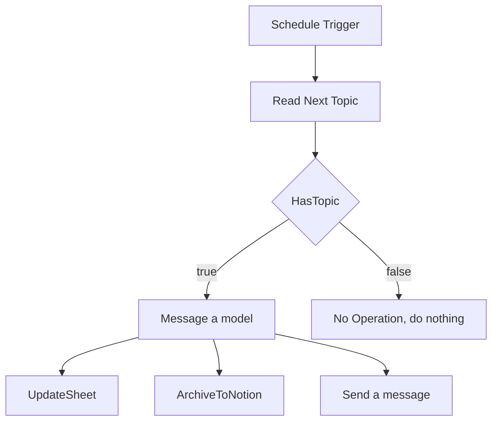
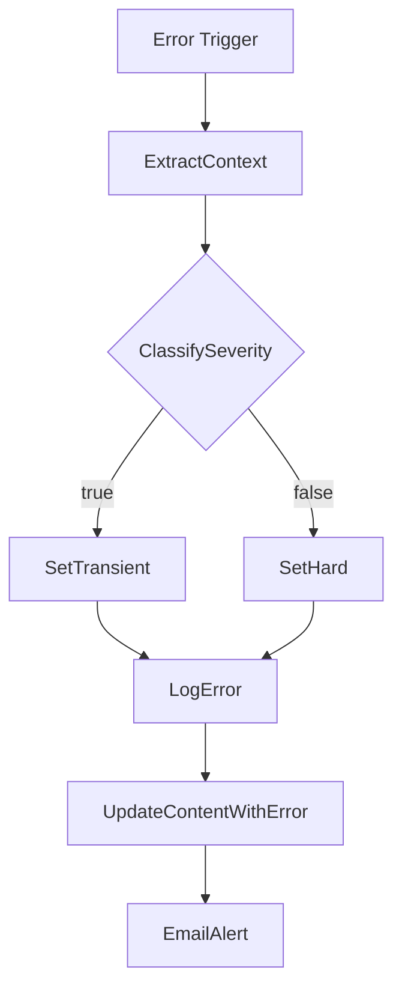

# n8n LinkedIn Content Pipeline

A scheduled n8n workflow that takes the day's topic from a Google Sheets content calendar, drafts a LinkedIn post with an OpenAI model, files the draft in Notion and the sheet, and emails it to me for review. A second workflow logs any failure and sends an alert.


## What I built

Posting on LinkedIn regularly comes with a routine part: working out what today's post is about, getting a first draft down, and keeping track of what has been drafted and what has not. This workflow handles that routine part. The content calendar lives in a Google Sheet where each row has a topic, an angle, a scheduled date, and a status.

Every day a Schedule Trigger starts the run. The workflow looks for the row whose status is `idea` and whose scheduled date is today. If it finds one, it asks an OpenAI chat model for a post that follows a fixed set of rules, then updates the sheet row to `drafted`, creates a page in a Notion database, and emails me the draft with links to both. Nothing is published to LinkedIn. I read the draft, edit it, and post it myself. If no row matches today, the run ends without doing anything.

## How it works

The main workflow is in `workflow.json`.

1. **Schedule Trigger** starts the run on a daily schedule.
2. **Read Next Topic** (Google Sheets) reads the `Content` tab and filters for `Status` equal to `idea` and `Date Scheduled` equal to today in `dd/MM/yyyy` format. It returns the first match only, and it still outputs an empty item when nothing matches so the next step can handle that case.
3. **HasTopic** (IF) checks that `Topic` is not empty and `Status` equals `idea`. The true branch goes to the model. The false branch goes to **No Operation, do nothing**.
4. **Message a model** (OpenAI, `gpt-4o-mini`, temperature 0.7, max 800 tokens) receives a system prompt that sets the role and the rules for the post, and a user message with the Day, Topic, Angle, and Source URL from the row.
5. The model output fans out to three nodes at the same time:
   - **UpdateSheet** finds the row by `Day` and writes the `Draft`, sets `Status` to `drafted`, and stamps `Sheet_Updated`.
   - **ArchiveToNotion** creates a page in the LinkedIn Draft database with the topic as the title, plus Angle, Day, Status, and Draft properties.
   - **Send a message** (Gmail) emails the draft with links to the sheet and the Notion database.



The error workflow is in `workflow-error-handler.json` and is attached to the main workflow through its Error Workflow setting.

1. **Error Trigger** fires when the main workflow fails.
2. **ExtractContext** collects the failed node, error message, HTTP code, execution link, affected day, workflow name, and a timestamp.
3. **ClassifySeverity** (IF) sends HTTP 429 and 500 or higher down one branch, and everything else down the other. **SetTransient** or **SetHard** then sets the `severity` field.
4. **LogError** appends a row to the `Errors` tab.
5. **UpdateContentWithError** sets the matching `Content` row to `error`.
6. **EmailAlert** sends a table of the failure details with a link to the execution.



## Key benefits

- A draft is waiting for review on the day a topic is scheduled, without me opening a blank page.
- The sheet works as the single list of topics and shows at a glance what is `idea`, `drafted`, or `error`.
- One model call is written to three places: the sheet, Notion, and my inbox.
- A fixed system prompt keeps every draft to the same length and shape (hook, body, closing question, a few hashtags).
- Failures are logged with a link to the exact execution and split into transient and hard errors, so I know whether a retry is likely to help.

## Tech stack

| Part | Tool |
| --- | --- |
| Automation | n8n (the alert link in the error workflow points to n8n Cloud; self-hosted also works) |
| Content calendar and error log | Google Sheets |
| Drafting | OpenAI chat model, `gpt-4o-mini` |
| Draft archive | Notion database |
| Notifications | Gmail |

## Setup

The short version is below. The full steps are in [docs/setup.md](docs/setup.md) and the credential details are in [docs/credentials.md](docs/credentials.md).

1. Create a Google Sheet with a `Content` tab and an `Errors` tab using the headers in `sample-data/`.
2. Create a Notion database with the properties listed in the setup guide.
3. In n8n, import `workflow-error-handler.json` first, then `workflow.json`.
4. Create the Google Sheets, OpenAI, Notion, and Gmail credentials and attach them to the nodes.
5. Replace the placeholders (sheet ID, Notion database ID, your email, your name, your n8n host).
6. In the main workflow's settings, choose the imported error workflow as the Error Workflow.
7. Run once with a row scheduled for today, check the result, then activate both workflows.

## Example

Input row read from the `Content` tab (invented sample data):

```json
{
  "Day": "1",
  "Date Scheduled": "06/11/2026",
  "Topic": "Write the handoff note before you log off",
  "Angle": "Common mistake fix: handoffs that only live in one person's head",
  "Status": "idea"
}
```

The workflow returns a draft in the format below, saves it, and emails it. The full input and output files are in `sample-data/input-example.json` and `sample-data/output-example.json`.

```text
Most handoffs fail quietly. Nobody notices until the person who knew
everything is offline and a client is waiting on an answer.

The fix is small. Before you log off, write three lines somewhere the
team can see them: what is finished, what is still open, and where the
next person should look first. It does not need a template or a meeting.
...
What is the one thing on your current project that only you know right now?

#RemoteWork #Operations #VirtualAssistant #Productivity
```


## Customizing it

- **The writing rules:** edit the system message in the Message a model node (length, tone, hashtags, closing line).
- **The model:** change the model and the max tokens in the same node.
- **The schedule:** change the rule in Schedule Trigger.
- **The date format:** the lookup in Read Next Topic uses `dd/MM/yyyy`. Change the expression if your sheet shows dates differently.
- **The destinations:** remove or replace UpdateSheet, ArchiveToNotion, or Send a message. They are independent branches.
- **The alert rules:** change the HTTP codes in ClassifySeverity.

## Limitations

- It drafts only. It does not post to LinkedIn, and every draft needs a human read for tone and accuracy. The Source URL is passed to the model as text, and the workflow does not open the page.
- It handles one topic per run, because Read Next Topic returns the first match only. If two rows share today's date, only the first is drafted.
- The sheet update matches on `Day`, so each row needs a unique `Day` value.
- The three output branches run in parallel. If one fails, the others may already have succeeded, and the error workflow will then mark the row `error` even though a draft exists.
- The error workflow reads the affected day from the error context. n8n does not always include a `Day` value there, in which case it records `unknown` and the status update has no row to match. Check this against a real failed run.
- ClassifySeverity compares the HTTP code with strict type checking, and the code arrives as text. Errors without an HTTP code may not classify the way the branches suggest. Check this against a real failed run as well.
- The Schedule Trigger contains two rules, and the second one is empty. Open the node to confirm the times it fires.
- The sample data in this repository is invented.

## Conclusion

This project shows a small, complete automation: a trigger, a lookup, a branch for the no-work case, an AI step with a tight prompt, three outputs, and a separate workflow that records failures. A sensible next step would be a second workflow that watches for a row marked `approved` and handles the posting step, but I would keep the human review in between.

## Author

Paidamoyo, Clarity Desk ("Turning Chaos into Clarity")

- LinkedIn: YOUR_LINKEDIN_URL
- Upwork: YOUR_UPWORK_URL
- Website: YOUR_WEBSITE_URL
