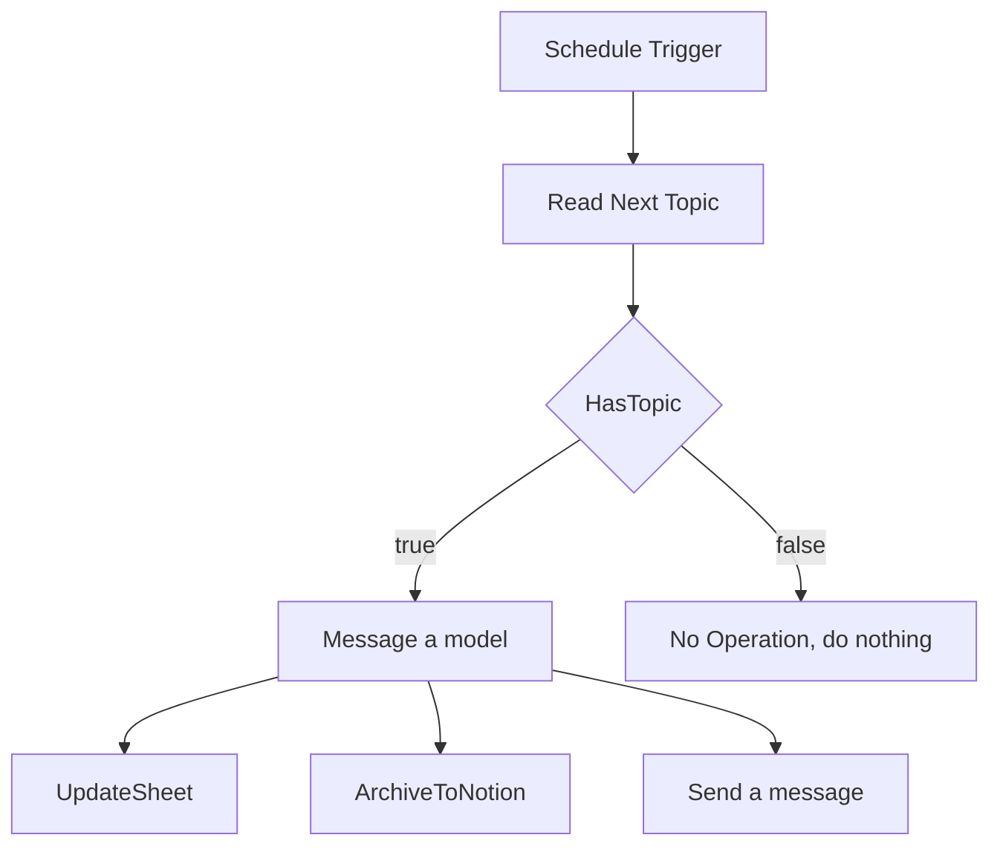
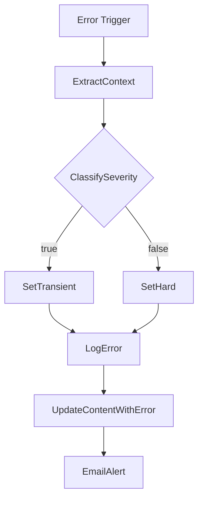

# Architecture

Two workflows work together. The content pipeline drafts the post. The error handler records failures. The pipeline points to the handler through its Error Workflow setting.

## Content pipeline (`workflow.json`)

| Node | Type | What it does |
| --- | --- | --- |
| Schedule Trigger | Schedule Trigger | Starts the run. The node has two rules: one at hour 1 and one empty rule. |
| Read Next Topic | Google Sheets | Reads the `Content` tab, filtered by `Status` = `idea` and `Date Scheduled` = today (`dd/MM/yyyy`). Returns the first match only. Always Output Data is on, so an empty result still continues. |
| HasTopic | IF | True when `Topic` is not empty and `Status` equals `idea`. |
| No Operation, do nothing | No Op | End of the false branch. |
| Message a model | OpenAI | Model `gpt-4o-mini`, temperature 0.7, max 800 tokens. The system prompt sets the role (LinkedIn ghostwriter for an Executive VA and AI Workflow Specialist) and the rules: hook in the first line that does not start with "I", 150 to 250 words, conversational but professional, one closing question or call to action, hashtags only at the end (3 to 5). The user message passes Day, Topic, Angle, and Source URL. |
| UpdateSheet | Google Sheets (update) | Matches on `Day`. Writes `Draft`, `Status` = `drafted`, `Sheet_Updated`, and carries over `Topic`, `Angle`, `Date Scheduled`, and `Timestamp`. |
| ArchiveToNotion | Notion | Creates a database page. Title is the topic. Properties: `Angle`, `Day`, `Status` = `drafted`, `Draft`. |
| Send a message | Gmail | Sends an HTML email with the day, topic, draft, and links to the sheet and the Notion database. |

The model returns its text at `output[0].content[0].text`, and all three output nodes read from that path.

## Error handler (`workflow-error-handler.json`)

| Node | Type | What it does |
| --- | --- | --- |
| Error Trigger | Error Trigger | Receives the failed execution's data. |
| ExtractContext | Set | Builds `failed_node`, `error_message`, `execution_url`, `affected_day`, `workflow_name`, `http_code`, and `Timestamp`. |
| ClassifySeverity | IF (OR) | True when the HTTP code equals 429, equals 500, or is greater than or equal to 501. |
| SetTransient | Set | Sets `severity` to `transient`. |
| SetHard | Set | Sets `severity` to `hard`. |
| LogError | Google Sheets (append) | Adds a row to the `Errors` tab. |
| UpdateContentWithError | Google Sheets (update) | Matches the `Content` row on `Day` and sets `Status` to `error`. |
| EmailAlert | Gmail | Sends an HTML table of the failure with a link to the execution. |

## Data contracts

### `Content` tab

`Day`, `Date Scheduled`, `Topic`, `Angle`, `Source_URL`, `Status`, `Draft`, `Notion_URL`, `Sheet_Updated`, `Notes`, `Timestamp`

Status values used by the workflows: `idea` (picked up), `drafted` (written by the pipeline), `error` (written by the error handler).

### `Errors` tab

`Timestamp`, `workflow`, `failed_node`, `error_message`, `http_code`, `execution_url`, `affected_day`, `severity`

### Notion database

| Property | Type | Value written |
| --- | --- | --- |
| Title | Title | Topic |
| Angle | Text | Angle |
| Day | Number | Day |
| Status | Select | `drafted` |
| Draft | Text | Model output |

## Things to know when changing it

- The three output nodes are not chained. A failure in one does not stop the other two.
- `Notion_URL`, `Source_URL`, and `Notes` are never written by the pipeline. `Source_URL` is only read and passed to the model as text.
- The error handler's Error Workflow setting was removed from the exported file so it does not point at itself.
